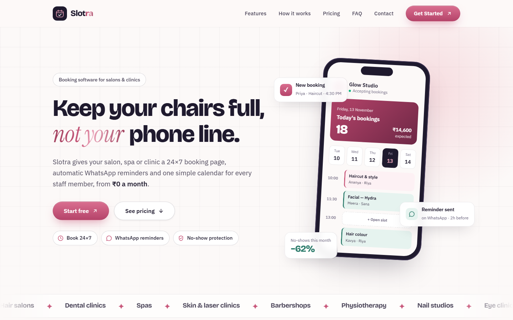
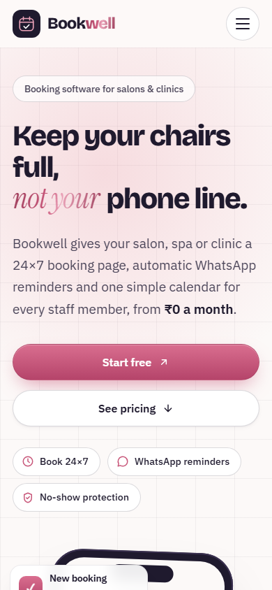
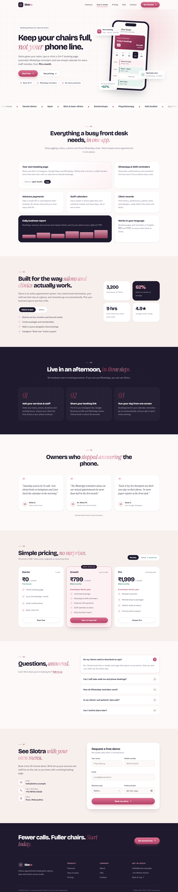
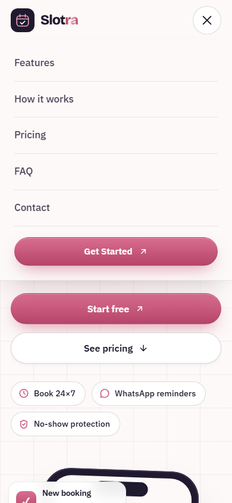
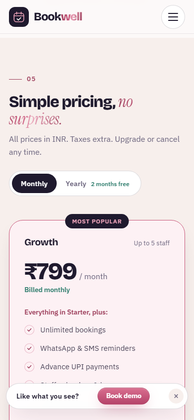

# Bookwell: Online Booking for Salons & Clinics

A premium, responsive landing page for **Bookwell**, a made-up SaaS product that gives salons, spas and clinics:

- a 24×7 online booking page
- WhatsApp reminders
- staff calendars
- advance payments

It was built for a front-end assignment with plain **HTML, CSS and JavaScript**, with no frameworks and no build step.

**About the name:** *Bookwell* combines **book** (appointments) and **well** (wellness, beauty and health). It says what the product does and who it's for.

**Source code:** <https://github.com/shravankasar37/adarshwork>

## Run locally

The site is not deployed online. It runs straight from the files, and no installation is needed.

1. Download the ZIP, or clone the repo:
   ```bash
   git clone https://github.com/shravankasar37/adarshwork.git
   ```
2. Open the folder and double-click `index.html` to open it in Chrome, Edge or Firefox.

You can also serve it with a local server:

```bash
python -m http.server 8000
```

Then open <http://localhost:8000>.

## Technologies used

| Tech | Used for |
|------|----------|
| HTML5 | Semantic structure (`header`, `nav`, `main`, `section`, `article`, `figure`, `details`, `footer`), ARIA roles for tabs, the modal and live messages |
| CSS3 | Design tokens (custom properties), CSS Grid and Flexbox, `clamp()` fluid type, `backdrop-filter`, gradients, keyframe animations, 4 breakpoints |
| JavaScript (ES6) | Mobile menu, scroll-spy, scroll-reveal and counters (`IntersectionObserver`), tabs, pricing toggle, FAQ accordion, form validation, modal, toast, sticky nudge |
| Google Fonts | **Bricolage Grotesque** (headings), **Instrument Serif** *italic* (accent words), **IBM Plex Sans** (body) |

There are no UI libraries or images. All icons are inline SVG, and the phone app mockup in the hero is built in HTML and CSS.

## Project structure

```
adarsh wrk/
├── index.html      # All page sections, the sign-up modal, the toast and the sticky nudge
├── styles.css      # Styling in 18 numbered sections: tokens → components → responsive
├── script.js       # Interactions in 12 numbered sections
├── screenshots/    # Desktop and mobile screenshots
└── README.md
```

## Sections

| Required section | What's on the page |
|---|---|
| Navigation bar | Logo, links to Features, How it works, Pricing, FAQ and Contact, plus a **Get Started** button. The bar is sticky and blurred, and becomes a hamburger menu on phones. |
| Hero | Headline, description, **Start free** (opens the sign-up form) and **See pricing** (scrolls down), feature chips, an animated phone mockup with floating cards, and a scrolling strip of industries |
| Features | A 7-card bento grid: booking page, reminders, payments, staff calendars, client records, reports and language support |
| About / How it works | A "Who it's for" section with **Salon / Clinic tabs** and animated stat counters, then a dark 3-step "How it works" section |
| Pricing | Starter ₹0, Growth ₹799 and Pro ₹1,999, with a **Monthly / Yearly** toggle (yearly = 2 months free) |
| Contact / Footer | A demo request form, contact details, an FAQ accordion, a footer call-to-action and link columns |

Testimonials and an FAQ are extra sections, added to make the page more convincing.

## Interactions

- **Navigation:** smooth scrolling to each section, with `scroll-padding-top` so headings never hide under the sticky bar. The current section's link is highlighted.
- **Mobile menu:** an animated hamburger that turns into ✕. It closes on link click or Esc, and `aria-expanded` stays in sync.
- **Demo request form:**
  - Validates the name, the mobile number (10 digits starting 6–9), the email, the business type and the date (not in the past).
  - Shows every error at once and focuses the first bad field.
  - Errors clear live as the user fixes them.
  - A valid submit shows a personalised success message plus a toast.
- **Sign-up modal:** opened by every Get Started and plan button, with the chosen plan shown. It validates the business name, email and terms checkbox, then shows a success screen with a generated booking-page link. It closes with ✕, Esc or a backdrop click, and focus returns to the button that opened it.
- **Pricing toggle:** switches prices and "billed yearly" totals, formatted in Indian style (₹19,990).
- **Tabs:** Salon / Clinic tabs, with arrow-key support.
- **FAQ:** only one answer is open at a time.
- **Scroll effects:** cards fade in one after another, and the stat counters count up when they come into view.
- **Sticky nudge:** a "Book demo" bar appears after the hero, hides at the contact section, and can be dismissed.
- **Accessibility:** visible focus rings and ARIA roles. `prefers-reduced-motion` turns off all animation.
- **No backend:** form submissions are simulated in JavaScript, as the brief allows.

## Screenshots

| Desktop | Mobile |
|---|---|
|  |  |
|  |   |

## Design choices and challenges

I wanted the page to feel premium and calm, like a good salon or clinic. I used:

- a deep **plum** for text and dark sections
- a **rose** accent for beauty and warmth
- a soft **sage** green for health and success messages
- blush-white backgrounds, with no pure white or grey

Headings pair a heavy grotesk font with *italic serif* accent words, which gives an editorial, high-end look. Every colour, radius and shadow is a CSS variable, so all sections stay consistent. The layout uses CSS Grid and collapses from 3 to 2 to 1 column at 1080, 900 and 600px. On phones the featured plan moves to the top.

Challenges I solved:
- **Scroll-reveal hiding content when JavaScript is off:** the hide class only applies when JS has added a `js` class to `<html>`.
- **The fade-out mask hiding the hero content:** I moved the grid background into a `::before` layer.
- **A lone card at the end of the bento grid:** I adjusted the column spans at each breakpoint so every row fills.
